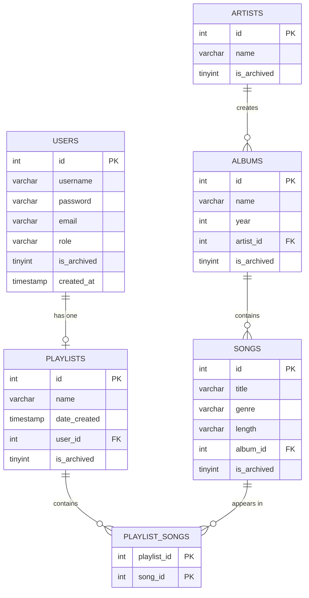

# 🎵 RecordingStudioCliApp

A Java console application for managing a recording studio's catalog of **artists, albums, songs, users, and playlists**. Built with **JDBC and MySQL** using a clean **3-tier architecture**, and built as my final project for the **Programming (Java) NC III** course.

---

## Table of Contents

- [Features](#features)
- [Tech Stack](#tech-stack)
- [Architecture](#architecture)
- [Project Structure](#project-structure)
- [Database Design](#database-design)
- [Use Cases](#use-cases)
- [Getting Started](#getting-started)
- [Running the App](#running-the-app)
- [Sample Usage](#sample-usage)
- [Design Decisions](#design-decisions)
- [Troubleshooting](#troubleshooting)
- [Author](#author)

---

## Features

- **Full CRUD** for Artists, Albums, Songs, Users, and Playlists
- **One playlist per user** (enforced in the service layer)
- **Soft delete (archive / restore)** for Artists, Albums, Songs, Users, and Playlists
- **Search** by keyword (Artists, Albums, Songs, Users)
- **Login and registration** with BCrypt password hashing
- **Role-based access control**:
  - `USER`: browse the catalog, search songs, and manage their own playlist
  - `ADMIN`: manage Artists, Albums, Songs, and Users
- **Many-to-many playlists**: add and remove songs in a playlist via junction table
- **User-friendly console UX**:
  - Screen clearing with ANSI escape codes between menus
  - Press **Enter to continue** after every action
  - **Y/N confirmation** before archive and delete actions
  - Box-drawing formatted tables for songs and playlists
- **SQL injection safe**: every query uses `PreparedStatement`

---

## Tech Stack

| Area | Technology |
|---|---|
| Language | Java 21 |
| Database | MySQL 8.4 |
| Data access | JDBC (`PreparedStatement`, try-with-resources) |
| Build tool | Maven |
| Password hashing | jBCrypt (`org.mindrot:jbcrypt:0.4`) |
| MySQL driver | `com.mysql:mysql-connector-j:26.7.0` |
| IDE (recommended) | IntelliJ IDEA |

---

## Architecture

The app follows a **3-tier architecture** with a strict one-way flow:

```
┌──────────────────────┐
│  Presentation Tier   │   Views: Scanner input, System.out output
└──────────┬───────────┘
           │ calls
┌──────────▼───────────┐
│     Service Tier     │   Business logic and validation
└──────────┬───────────┘
           │ calls
┌──────────▼───────────┐
│  Data Access Tier    │   Repositories: JDBC and SQL only
└──────────┬───────────┘
           │
        ┌──▼──┐
        │MySQL│
        └─────┘
```

| Tier | Responsibility | Must **not** |
|---|---|---|
| **Presentation** | Show menus, read input, display results and messages | Contain SQL or business rules |
| **Service** | Validate data, enforce rules, coordinate repositories | Read input or print UI messages |
| **Repository** | Run SQL through JDBC, map rows to objects | Print messages or validate business rules |

The **model** package (plain Java objects) and **config** package (database connection) are shared by all tiers.

**Key principles applied:** Separation of Concerns, DRY, composition over inheritance (constructor injection), and programming to interfaces.

---

## Project Structure

```
RecordingStudioCliApp
├── pom.xml
├── README.md
└── src/main/java/com/joysistvi/recordingapp
    ├── App.java                          # Entry point: wires the tiers together
    ├── config
    │   └── DbConnection.java            # Database connection settings
    ├── model
    │   ├── Artist.java
    │   ├── Album.java
    │   ├── Song.java
    │   ├── Playlist.java
    │   └── User.java
    ├── view                              # Presentation Tier
    │   ├── ArtistView.java
    │   ├── AlbumView.java
    │   ├── SongView.java
    │   ├── PlaylistView.java
    │   └── UserView.java
    ├── service                           # Business Logic Tier
    │   ├── ArtistService.java            (interface)
    │   ├── ArtistServiceImpl.java
    │   ├── AlbumService.java             (interface)
    │   ├── AlbumServiceImpl.java
    │   ├── SongService.java              (interface)
    │   ├── SongServiceImpl.java
    │   ├── PlaylistService.java          (interface)
    │   ├── PlaylistServiceImpl.java
    │   ├── UserService.java              (interface)
    │   └── UserServiceImpl.java
    └── repository                        # Data Access Tier
        ├── ArtistRepository.java         (interface)
        ├── ArtistRepositoryImpl.java
        ├── AlbumRepository.java          (interface)
        ├── AlbumRepositoryImpl.java
        ├── SongRepository.java           (interface)
        ├── SongRepositoryImpl.java
        ├── PlaylistRepository.java       (interface)
        ├── PlaylistRepositoryImpl.java
        ├── UserRepository.java           (interface)
        └── UserRepositoryImpl.java
```

---

## Database Design

**Database name:** `recording_studio_db`

### Entity relationships

- An **Artist** creates many **Albums**
- An **Album** contains many **Songs**
- A **User** has one **Playlist** (1:1, enforced in service layer)
- A **Playlist** contains many **Songs** (many-to-many through `playlist_songs`)



### Tables

| Table | Columns |
|---|---|
| `artists` | `id`, `name`, `is_archived` (default `0`) |
| `albums` | `id`, `name`, `year`, `artist_id` (FK → `artists`), `is_archived` (default `0`) |
| `songs` | `id`, `title`, `genre`, `length` (text, e.g. `3:45`), `album_id` (FK → `albums`), `is_archived` (default `0`) |
| `users` | `id`, `username` (unique), `password` (BCrypt hash), `email` (unique), `role` (`USER` or `ADMIN`, default `USER`), `is_archived` (default `0`), `created_at` |
| `playlists` | `id`, `name`, `date_created`, `user_id` (FK → `users`), `is_archived` (default `0`) |
| `playlist_songs` | `playlist_id` (FK), `song_id` (FK), composite primary key |

### Foreign key actions

| Constraint | Action |
|---|---|
| `albums.artist_id` → `artists.id` | `ON DELETE RESTRICT`, `ON UPDATE CASCADE` |
| `songs.album_id` → `albums.id` | `ON DELETE RESTRICT`, `ON UPDATE CASCADE` |
| `playlists.user_id` → `users.id` | `ON DELETE RESTRICT`, `ON UPDATE CASCADE` |
| `playlist_songs` → `playlists.id` / `songs.id` | `ON DELETE RESTRICT`, `ON UPDATE CASCADE` |

---

## Use Cases

**Both actors:** Login

**User:**
- Register Account
- Browse Artists, Albums, and Songs
- Search Songs
- Manage Own Playlist (create, view, delete)
- Add / Remove Songs in Playlist

**Admin:**
- Manage Artists 
- Manage Albums 
- Manage Songs (including archive and restore)
- Manage Users 

> Self-registration always creates an account with role `USER`. Admin accounts are seeded in the database or promoted manually.

---

## Getting Started

### Prerequisites

- **JDK 21** or newer
- **MySQL 8.x** running locally
- **Maven 3.8+** (or use the one bundled with IntelliJ IDEA)
- Git

### 1. Clone the repository

```bash
git clone https://github.com/jmsolamo/b426-csp1-solamo-jamesmichael.git
cd b426-csp1-solamo-jamesmichael
```

### 2. Create the database

Import the SQL dump in MySQL Workbench, phpMyAdmin, or the MySQL CLI:

```bash
mysql -u root -p < recording_studio_db.sql
```

This creates the `recording_studio_db` database, all tables, and sample data (artists, albums, songs, users, and playlists).

### 3. Configure the connection

Open `src/main/java/com/joysistvi/recordingapp/config/DbConnection.java` and update the credentials:

```java
private final static String URL = "jdbc:mysql://localhost:3306/recording_studio_db";
private final static String USERNAME = "root";
private final static String PASSWORD = "";
```

### 4. Create an admin account (optional)

The SQL dump includes a seeded admin account (`admin` / `admin123456`). To promote another user:

```sql
UPDATE users SET role = 'ADMIN' WHERE username = 'your_username';
```

---

## Running the App

### Option A: From IntelliJ IDEA

1. Open the project and let Maven import the dependencies.
2. Run `App.java`.
3. (Optional) To enable screen clearing, turn on **Run Configuration → Modify options → Emulate terminal in output console**.

### Option B: From the terminal (runnable JAR)

```bash
mvn clean package
java -jar target/RecordingStudioCliApp-1.0-SNAPSHOT.jar
```

### Option C: Build the jar with IntelliJ Artifacts

1. Go to **File → Project Structure → Artifacts**.
2. Click **+ (Add) → JAR → From modules with dependencies**.
3. Under **Main Class**, select `App`.
4. Click **OK**, then **Apply**.
5. Go to **Build → Build Artifacts → Build**.
6. Run from the project root:

```powershell
cd out\artifacts\RecordingStudioCliApp_jar
java -jar RecordingStudioCliApp.jar
```

> Rebuild the artifact (**Build → Build Artifacts → Rebuild**) every time you change the code.

---

## Screenshots

### Main / Authentication Menu


### Admin Dashboard


### Song Management Menu


### Active Songs (Formatted Table View)


---

## Sample Usage

```
----- Recording Studio App -----
1. Login
2. Register Account
0. Exit
Choose an option: 1

----- User Login -----
Enter Username: admin
Enter Password: admin123456

Welcome, admin (ADMIN)!

----- Admin Dashboard -----
1. Song Management
2. Artist Management
3. Album Management
4. Users Management
0. Logout
Choice: 1

----- Song Management -----
1. View All Active Songs
2. Create Song
3. Update Song
4. Search Songs
5. Archive Song
6. Restore Song
7. Delete Song
0. Back
Choose an option: 1

----- Active Songs -----
+-------+------------------------+-----------------+----------+----------------------+
| ID    | Title                  | Genre           | Length   | Album                |
+-------+------------------------+-----------------+----------+----------------------+
| 1     | LOSE MY NUMBER         | HIPHOP          | 3:16     | BACKSHOTS            |
| 2     | SI LODS NA BAHALA      | HIPHOP          | 3:32     | BACKSHOTS            |
| 3     | Origimal               | HIPHOP          | 2:38     | IMPAKTO              |
| 4     | Dugkat                 | HIPHOP          | 3:04     | IMPAKTO              |
| 5     | G                      | HIPHOP          | 4:48     | HARANASA             |
+-------+------------------------+-----------------+----------+----------------------+

Press Enter to continue...
```

---

## Design Decisions

- **Role stored as `VARCHAR`** (`USER` or `ADMIN`) instead of a boolean or enum to keep the code simple and beginner-friendly.
- **Soft delete for all entities** (`is_archived`) so data is never lost by accident and can be restored.
- **BCrypt for passwords**: plain-text passwords are never stored.
- **One playlist per user** enforced in the service layer, not by a database UNIQUE constraint, allowing clearer error messages.
- **Service layer owns validation**: guard clauses check for null, empty, and invalid IDs before calling the repository.
- **Repositories never print success messages**: they only log SQL errors and return boolean results.
- **Interfaces for services and repositories** so implementations can be swapped.
- **Song `length` stored as text** (for example, `3:45`) for simplicity.
- **Constructor injection** in `App.java` for clean dependency wiring.
- **ANSI escape codes** for `clearScreen()` to provide a clean terminal experience.

---

## Troubleshooting

| Problem | Fix |
|---|---|
| `No suitable driver found for jdbc:mysql://...` | Run the shaded jar (`java -jar target/...jar`), not `mvn exec:java` |
| `Access denied for user 'root'` | Check the `USERNAME` and `PASSWORD` values in `DbConnection.java` |
| `Unknown database 'recording_studio_db'` | Import the SQL dump first |
| `Communications link failure` | Make sure the MySQL server is running on port 3306 |
| Screen does not clear in IntelliJ | Enable **Emulate terminal in output console** in the Run Configuration |
| `mvn` is not recognized (Windows) | Add Maven's `bin` folder to the `PATH` environment variable and reopen the terminal |

---

## Author

- James Michael Solamo, Programming (Java) NC III, B426 Joysis Tech Voc Inc. GitHub: [@jmsolamo](https://github.com/jmsolamo)

---

## Acknowledgements & Resources

- **Course Instructor:** Jareth Ronquillo, Joysis Tech Voc Inc.
- **Starter Template & Resources:** [b426-csp1-template](https://github.com/sirjareth/b426-csp1-template)
